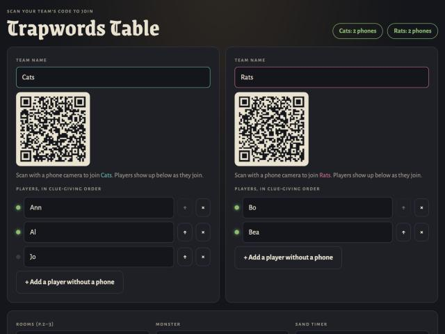
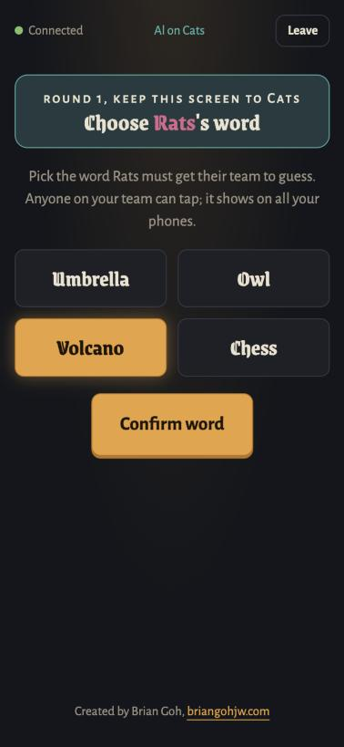
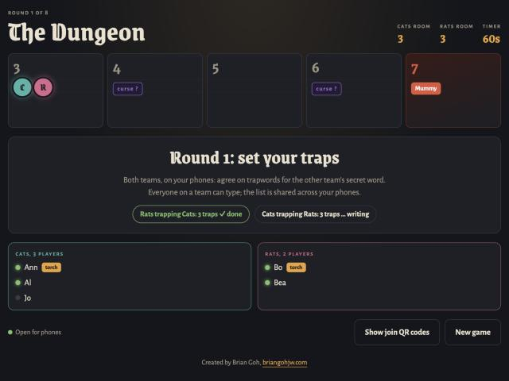
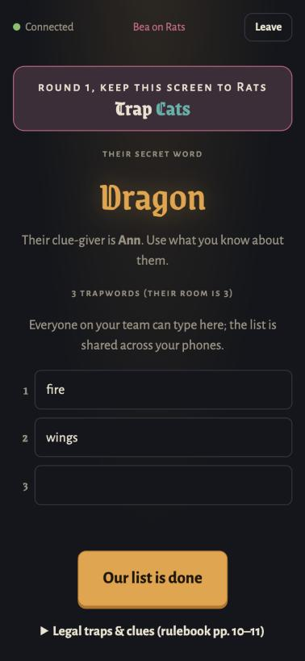
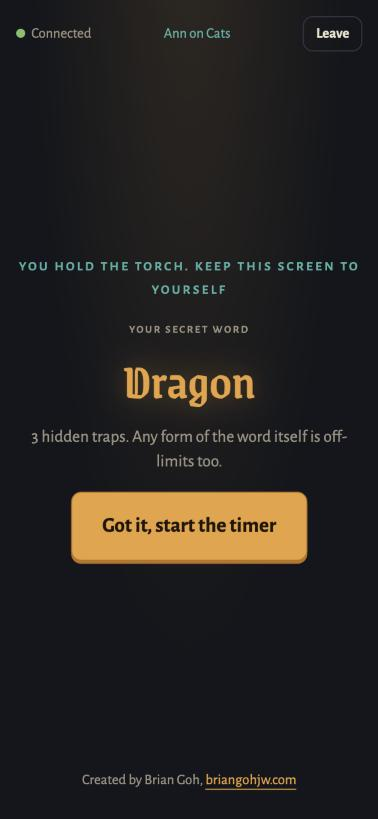
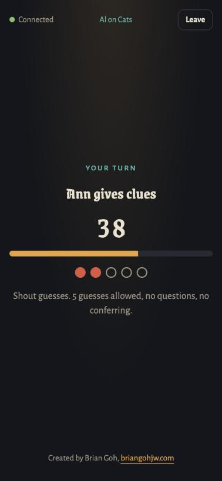
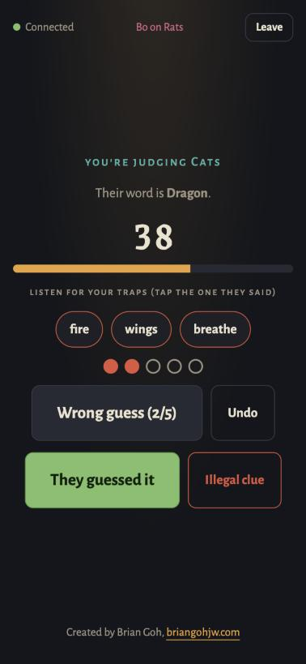
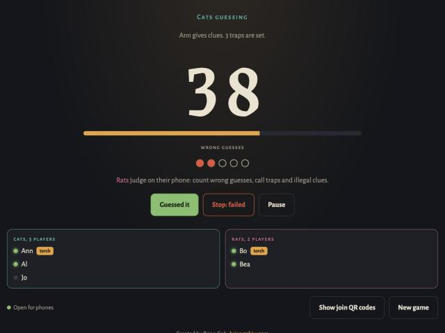

# Trapwords Table

A web version of the party game Trapwords, played around a table with one iPad and everyone's phones. There's no app to install. It runs in the browser.

Two teams race through a dungeon. Each round, your clue-giver tries to get your team to guess a secret word. The catch: the other team has set hidden "trapwords", and if your clue-giver says one, your turn is over.

## What you need

- One iPad, laptop or other big screen for the middle of the table. This is the **table screen**.
- One phone per player. A team can share a phone if they need to.
- An internet connection for every device.
- At least 2 players per team. Teams can be uneven.

## How to run it

The whole game is one file, `index.html`. There's nothing to install or build. You just have to put it at a web address that every device can open. Phones join by scanning a QR code that points to the same address as the table screen. So opening the file straight from your computer (a `file://` address) won't work for phones.

Devices connect to each other through a free public connection service (PeerJS), so every device needs internet. They don't have to be on the same Wi-Fi.

### Option 1: GitHub Pages (best for regular use)

1. Push this folder to a GitHub repository.
2. On GitHub, open the repository's **Settings > Pages**.
3. Under **Build and deployment**, choose **Deploy from a branch**, pick your main branch and the `/ (root)` folder, then save.
4. After a minute, GitHub shows the address, usually `https://<your-username>.github.io/<repository-name>/`.
5. Open that address on the table screen.

To update the game later, push the new `index.html` to the same branch. The site refreshes on its own.

### Option 2: Any static host

Upload `index.html` to any site that serves plain files, such as Netlify (drag and drop the folder at app.netlify.com/drop), Cloudflare Pages or your own web space. Open the address it gives you on the table screen.

### Option 3: From your own computer, for a quick test

Phones must be on the same Wi-Fi as the computer for this one. In a terminal, inside this folder:

```bash
python3 -m http.server 8000
```

Find your computer's local address. On a Mac, hold Option and click the Wi-Fi icon to see the "IP Address", for example `192.168.1.20`. Then open `http://192.168.1.20:8000` on the table screen, not `localhost`, so the QR codes point somewhere the phones can reach. Stop the server with Ctrl+C when you're done.

A real https address (options 1 and 2) works best. Some phone features, like keeping the screen awake, only work over https.

## Starting a game

1. On the table screen, open the page and tap **Host a new game**.
2. Each team has a QR code. Players scan their team's code with their phone camera and type their name.
3. Players appear on the table screen as they join. The order of names is the order people take turns giving clues. Use the arrows to change it.
4. Pick the settings (see below) and tap **Enter the dungeon**.



If someone joins late or their phone drops out, they can scan the code again. They'll catch up straight away. If a friend has no phone, add them by hand with **Add a player without a phone**.

## How a round works

### 1. Choose the other team's word

Each team sees 4 words on their phones. Choose the one the **other** team will have to guess. Anyone on the team can tap a word, and the choice shows on all of your team's phones. When you agree, tap **Confirm word**.

The round moves on once both teams have confirmed.



While this happens, the table screen shows the dungeon: where each team is, the monster in the last room, and the face-down curses.



### 2. Set traps

Now write your trapwords. These are words you think the other team's clue-giver will be tempted to say.

- The number of traps you write equals the room number the other team is standing in. If they're in room 3, you write 3 traps.
- Everyone on your team can type on their own phone. The list is shared.
- Tap **Our list is done** when you're happy with it.

Your phones also show who the other team's clue-giver is. Use what you know about them.




### 3. Give clues

The team that is behind goes first. If both teams are level, the first turn alternates each round.

- **The clue-giver** sees the secret word on their own phone. When they've read it, they tap **Got it, start the timer**.
- **The guessers** shout out guesses. They only see the timer and how many guesses are left.
- **The other team** listens and judges on their phones. They tap **Wrong guess** to count misses. If the clue-giver says one of their traps, they tap that trap. They tap **They guessed it** if the team gets it.

| Clue-giver | Guesser | Other team |
| --- | --- | --- |
|  |  |  |

The table screen shows the big timer for everyone to see.



Your turn ends when:

- your team guesses the word, and you move forward one room
- the clue-giver says a trapword, or any form of it
- the clue-giver gives an illegal clue
- your team makes 5 wrong guesses
- time runs out

Then the other team takes their turn.

### 4. End of the round

If neither team guessed their word, the monster moves one room closer. The person giving clues passes to the next player on each team.

If a call was unclear, talk it over. The result can be changed on the table screen before you move on.

## Winning

Reach the monster's room. When your team starts a round in the same room as the monster, you're fighting it, and the monster adds its own rule. Guess your word that round and you win.

- If both teams beat the monster in the same round, both win, unless you turned on the tiebreaker.
- If nobody beats the monster within 8 rounds, the monster wins.

## Clue rules

The clue-giver may not:

- say the secret word or any form of it
- say any trapword or any form of it. "Base" or "ball" both trigger the trap *baseball*, and "daylight" triggers *light*.
- give examples of the word. For DOG, you can't name dog breeds.
- use names of people, places, brands or titles
- give clues about how the word sounds or is spelled ("rhymes with", "starts with B")
- point at things in the room, or use gestures

Guessers can't ask questions or talk it over. A guess counts if it contains the word: "hot dog" is correct for DOG.

Only the clue-giver can trigger traps. Guessers can say trapwords freely, unless the Snare curse is in play.

A trap only counts if someone catches it within a few seconds.

## Curses

Some rooms hold a face-down curse. It's revealed when a team enters that room, and it applies to that team for one round only. It's then discarded.

| Curse | What it does |
| --- | --- |
| Not That | The clue-giver may only say what the word is *not*. |
| One Syllable | Every word the clue-giver says must be one syllable. |
| Hexed Ink | The other team writes 2 extra trapwords against you. |
| Dim Sight | Your team gets only 3 guesses. |
| Sudden Death | Your team gets only 1 guess. |
| Cracked Hourglass | Half the usual time. |
| Snare | Traps catch guessers too. If anyone guesses a trapword, the turn ends. |

The app handles the guess limits, the timer and the extra traps for you. The other team judges the rest.

If no team advances, the monster moves closer. When it moves into a room with a curse, the curse is pushed one room closer to the players.

## Settings

- **Rooms:** The recommended setup is rooms 3 to 7 with 2 curses. The alternative is rooms 2, 4, 6, 8 and 10 with curses in the first 4 rooms. This one is longer and harder.
- **Monster:**
  - Mummy: one random curse each round you fight it.
  - Mummy (nastier): two random curses at once.
  - Ogre: only 3 guesses.
  - Banshee: the clue-giver may only whisper.
  - Custom: write your own rule.
- **Sand timer:** 45 to 120 seconds per turn. 60 is a good start.
- **Use curses:** turn off for a first game if people are still learning.
- **Alternative tiebreaker:** if both teams fight the monster, the faster team wins.

## Tips for new players

- Clue-givers: the obvious word is probably trapped. Go around it.
- Trap-setters: think about how *this* clue-giver talks. Do they always say "like" or "basically"? Pick words they'd naturally reach for, not just the most obvious ones.
- Guessers: just blurt it out. Thinking too long wastes the timer.

## Troubleshooting

- **A phone says it can't reach the table:** keep the table screen open on the game page. Phones reconnect by themselves.
- **The table screen was closed or reloaded:** open the page again and tap **Resume the last game**.
- **Someone is on the wrong team:** before the game starts, they can tap **Switch** on their phone.

## Credits

This is an unofficial, non-commercial fan project. It isn't made by or affiliated with Czech Games Edition. If you enjoy it, please support the creators by buying the board game.

**Trapwords** is published by Czech Games Edition (© 2018, czechgames.com).

- **Game design:** Jan Březina, Martin Hrabálek, Michal Požárek
- **Illustration:** Regis Torres, Dávid Jablonovský
- **Art direction and layout:** Filip Murmak, Michaela Zaoralová
- **Additional art:** Radim "Finder" Pech, František Sedláček
- **Words and rulebook:** Jason Holt

The rules in this guide are summarized from the official rulebook. The curses, extra monsters, word lists and phone features are this project's own house rules. They aren't part of the original game.

This web version was made by Brian Goh ([briangohjw.com](https://briangohjw.com)).
